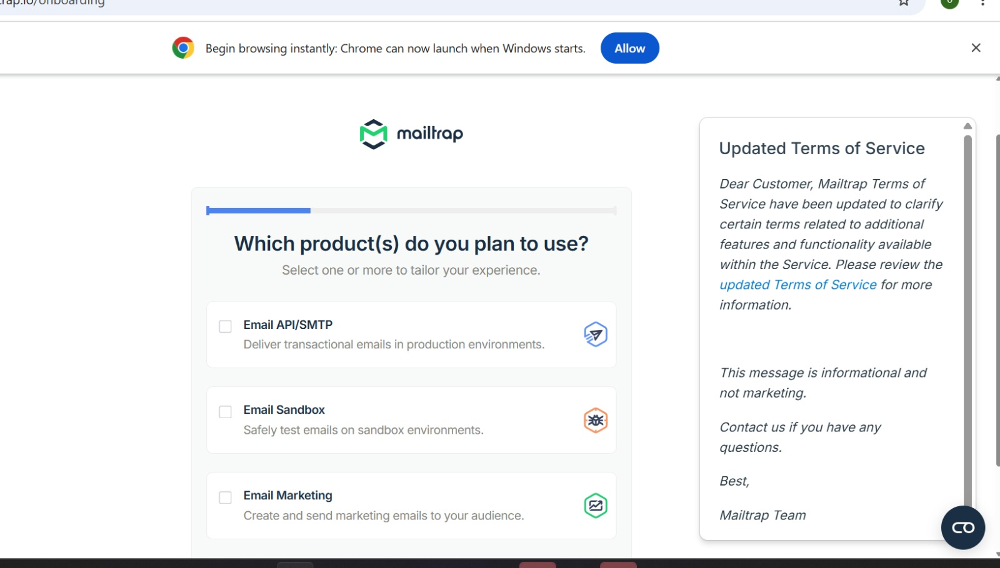

# GoPhish Cybersecurity Project: Phishing Simulation Lab

This project demonstrates how to set up and execute a safe, controlled phishing simulation using the GoPhish framework on Kali Linux. The goal of this lab is to understand how credential-harvesting attacks work so we can build better corporate security defenses.

## 🚀 Lab Infrastructure
* **Simulation Platform:** GoPhish Framework (Running on Kali Linux VM)
* **Target Receiver Account:** Secure Proton Mail (`projecttestuser1@proton.me`)
* **Safe Mail Gateway:** Mailtrap SMTP Sandbox (Used to safely route testing emails without risking personal accounts)

---

## 🛠️ Step-by-Step Implementation

Open your Kali Linux terminal and run the following commands to install and start the framework:
```bash
# Update the local software packages
sudo apt update

# Install the native GoPhish package
sudo apt install gophish -y

# Start the simulation framework server
sudo gophish
```

---

## 📸 Project Evidence & Screenshots

Here is the visual proof of the working lab setup:

---
### Phase 1: GoPhish Administrative Dashboard Overview
*Initial system verification and landing screen.*


---
### Phase 2: Scenario Design (Email Template)
*Creating the urgent security alert email using the tracking link tags.*


---
### Phase 3: Fake Login Interface (Landing Page)
*The custom HTML verification page designed to record test credentials.*


---
### Phase 4: Delivery Gateway & Campaign Settings
*Connecting GoPhish to Mailtrap and launching the test campaign.*



---
### Phase 5: Live Campaign Results (Final Proof)
*Real-time analytics showing successful delivery, opening, link interaction, and credential submission.*


---

## ⚠️ Technical Challenges & Solutions

### 1. Webmail Registration Restrictions
* **Challenge:** My initial test target account was flagged by automated spam controls, causing a 48-hour hold.
* **Solution:** Pivoted immediately to **Proton Mail**, which allowed instant registration via basic image CAPTCHA verification.

### 2. Standard Mail Server Blocks
* **Challenge:** Normal public email servers block automated simulation emails containing words like "unusual sign-in activity" to prevent platform abuse.
* **Solution:** Utilized **Mailtrap Sandbox** as an isolated SMTP gateway. This allowed GoPhish to deliver the test email into a safe environment without account suspensions.

### 3. Loopback Localhost Error
* **Challenge:** Clicking the tracking link from my host computer's browser caused a network timeout error because the address resolved locally to `127.0.0.1`.
* **Solution:** Opened the Mailtrap dashboard browser session directly inside the **Kali Linux VM**. This allowed the loopback address to connect seamlessly to the listening GoPhish server.

### 4. Zero (0) Email Reported Metric Explanation
* **Challenge:** The final results screen showed zero reports, which could look like a system bug.
* **Solution:** This is correct behavior. Standard mail clients require specific reporting plugins. The zero status simply proves that the target user fully trusted the phishing lure.

---

## 🛡️ Strategic Security Takeaways
* **Pretexting Sophistication:** High-quality alert designs make it very easy to trick users, showing why we need strong user awareness training.
* **Defensive Tracking:** The lack of automated reporting during this test underscores why organizations must give users an easy "Report Phishing" button.
* **Technical Controls:** Strong multi-factor authentication (MFA) remains the best defense to stop attackers from using stolen static passwords.

---

## 🎓 About the Author
* **Name:** Olagunju Olakiitan Esther
* **Role:** Cybersecurity Graduate Intern
* **Connect with me:** [My LinkedIn Profile:https://www.linkedin.com/in/olagunju-olakiitan/)

---
*Disclaimer: This repository is intended strictly for authorized educational research and laboratory practice. No real targets were phished or harmed during this simulation loop.*
